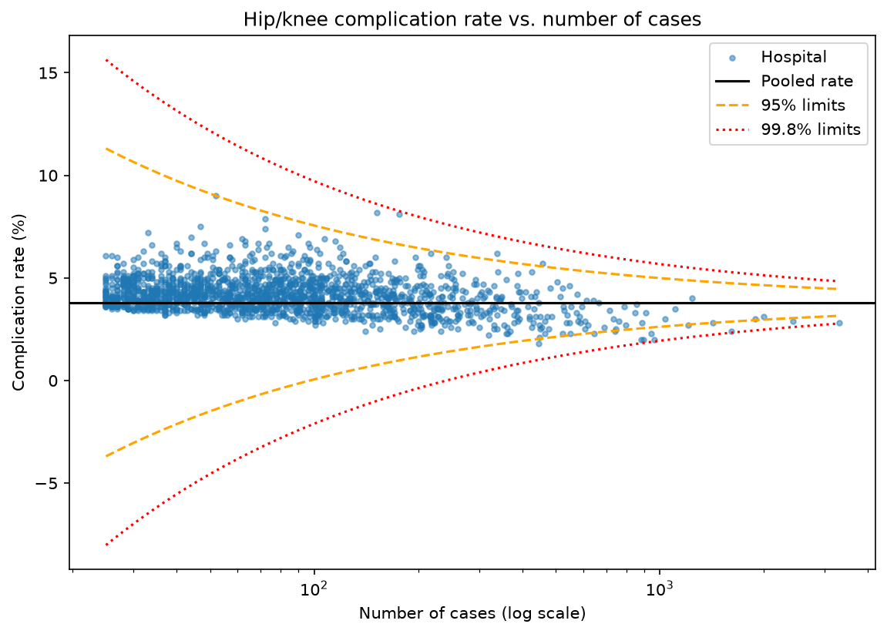

# Hip/Knee Replacement Quality Monitor

An analysis of public CMS hospital data asking one question: **how much weight should anyone give to a single hospital's published hip/knee replacement complication rate, given how many cases it is based on?**

**Status:** In progress. Data cleaning and the statistical analysis are done. The interactive app, tests, and methodology confirmation are next.



## Why this question

Hospitals that perform few procedures produce noisy rates, so a raw ranking can make a small hospital look like the best or worst in the country when the difference is mostly chance. CMS documentation describes labeling a hospital better or worse than the national rate only when its entire 95% interval falls on one side of that rate. In the file used here, the interval and national-comparison columns are empty for the hip/knee measure, so this project builds approximate limits from case counts and investigates how the published rates behave. The full framing is in [PROBLEM.md](PROBLEM.md).

## Data

All data is public and comes from the CMS Provider Data Catalog (data.cms.gov/provider-data). Everything is hospital-level and aggregated. No patient-level information is used.

| File | What it contains |
|---|---|
| `Complications_and_Deaths-Hospital.csv` | One row per hospital per measure (95,800 rows). This project uses the 4,790 hip/knee complication rows (`COMP_HIP_KNEE`), which include a case count and a rate. The interval columns are empty for this measure. |
| `CJR_Quality_Reporting_January_2026_Production_File.csv` | The Comprehensive Care for Joint Replacement model file: 320 hospitals with a hip/knee complication rate, percentile ranks, and patient-survey scores. 312 of the 320 hospitals match the hospital file. This file has not been analyzed beyond matching yet. |

### Data notes

- **Facility IDs lose their leading zeros in one file.** The same hospital appears as `10023` in one file and `010023` in the other. IDs are read as text and padded to 6 digits before the files are matched.
- **The files cover different time windows.** In the rows inspected, the CJR complication window (04/01/2021 to 03/31/2024) and the hospital-file window (04/01/2023 to 03/31/2025) differ, so their rates are not treated as the same measurement.
- **Missing values are stored as text.** Many cells say "Not Available" instead of being empty, so those columns are converted to numbers and the placeholders become true missing values.
- **Only 1,706 of 4,790 hospitals (36%) have a reported rate.** The smallest case count among them is 25. Footnote codes 1, 5, 7, and 19 appear only on hospitals with no rate and account for all 3,084 of them. Footnote 29 appears on 33 hospitals that do have a rate. What each code means has not yet been confirmed from the CMS data dictionary. Results describe reporting hospitals only.

## Findings so far

- **The funnel plot flags far fewer hospitals than chance would predict.** With a case-weighted pooled rate of 3.81%, 16 of 1,706 hospitals fall outside the 95% limits (4 high, 12 low), versus about 85 expected by chance alone. None fall outside the 99.8% limits. This means the funnel's limits do not describe this data, and those 16 hospitals should not be called outliers.
- **The published rates look smoothed for small hospitals.** Splitting hospitals into four size groups, the real spread of rates barely changes with case count, while the spread chance alone would produce falls by almost two-thirds:

  | Size group | Cases | Real spread (pts) | Chance spread (pts) | Ratio |
  |---|---|---|---|---|
  | Smallest | 25-42 | 0.68 | 3.38 | 0.20 |
  | Small-mid | 43-73 | 0.85 | 2.57 | 0.33 |
  | Large-mid | 74-134 | 0.84 | 1.96 | 0.43 |
  | Largest | 135+ | 0.89 | 1.27 | 0.70 |

  This is consistent with CMS risk-standardized rates being pulled toward the average for small hospitals. The mechanism has not yet been confirmed against CMS methodology documents.
- **Hospitals with more cases tend to have somewhat lower published rates** (Spearman rho = -0.26, n = 1,706). The data cannot show whether this reflects real differences in care, the smoothing, or patient mix.
- **State-level rates sit in a narrow band.** Case-weighted rates run from about 3.2% (NY) to 4.7% (GA), with Puerto Rico lowest at 2.7%. They are smoothed and carry no uncertainty at the state level, so states are not ranked here.
- **The share of hospitals with a reported rate varies widely by state** (14% to 69%). This partly reflects how many hospitals in a state perform joint replacements at volume, and is not purely a measure of data quality. A weak negative relationship between that share and a state's rate (rho = -0.32 with Puerto Rico, -0.27 without) is not robust.
- **Implication:** a published rate for a small hospital carries little hospital-specific information, so it should not be over-interpreted.

## Project structure

```
hipKnee/
├── data/
│   ├── CJR_Quality_Reporting_January_2026_Production_File.csv
│   ├── Complications_and_Deaths-Hospital.csv
│   └── processed/              # cleaned copies created by clean.py
├── outputs/
│   └── funnel_plot.png         # created by funnel.py
├── explore.py                  # prints the structure of each raw file
├── clean.py                    # cleans data and saves analysis-ready tables
├── funnel.py                   # funnel plot and count of hospitals outside limits
├── diagnose.py                 # spread of real rates vs. chance, by hospital size
├── state_summary.py            # SQL (DuckDB) summary of rates by state
├── reporting_check.py          # footnote check and correlation tests
├── PROBLEM.md                  # problem statement and assumptions
├── requirements.txt
└── README.md
```

## How to run it

```bash
git clone https://github.com/zaaferahhamid/hip-knee.git
cd hip-knee
python -m venv .venv
source .venv/bin/activate        # Windows: .venv\Scripts\activate
pip install -r requirements.txt

python explore.py                # look at the raw files
python clean.py                  # create the cleaned files in data/processed/
python funnel.py                 # funnel plot -> outputs/funnel_plot.png
python diagnose.py               # real vs. chance spread by hospital size
python state_summary.py          # SQL summary by state
python reporting_check.py        # footnotes and correlations
```

Run `clean.py` first, since the other scripts read its output.

## Limitations

- The data is aggregated, so it can show that hospitals differ but not why.
- Rates are risk-standardized by CMS, and appear to be smoothed. The raw, unsmoothed rates are not in the file, so real hospital differences cannot be separated from noise here.
- The funnel plot's center line is the case-weighted average of reporting hospitals, used as a stand-in for the national rate. The national file has not been used yet.
- The funnel's binomial limits assume raw proportions, which these rates are not, so they are an approximation.
- Hospitals without a reported rate are excluded, so findings describe reporting hospitals only.
- Several comparisons were run, so isolated p-values should be read cautiously.
- This project is for learning and portfolio purposes and is not intended to guide clinical or purchasing decisions.

## Roadmap

- [x] Explore the raw files and document their structure
- [x] Clean the data and fix the Facility ID mismatch
- [x] Write a problem statement
- [x] Funnel plot and check of how the published rates behave
- [x] SQL summary by state
- [ ] Confirm the smoothing method and footnote definitions from CMS documentation
- [ ] Interactive Streamlit app with a hospital lookup and plain-language explanations
- [ ] Unit tests for the cleaning and statistics code
- [ ] Compare the case-weighted average with the national rate from the national file
- [ ] Analyze the CJR file (patient-survey scores and the 8 unmatched hospitals)

## Tech stack

Python, pandas, NumPy, SciPy, Matplotlib, DuckDB (SQL), Streamlit, pytest